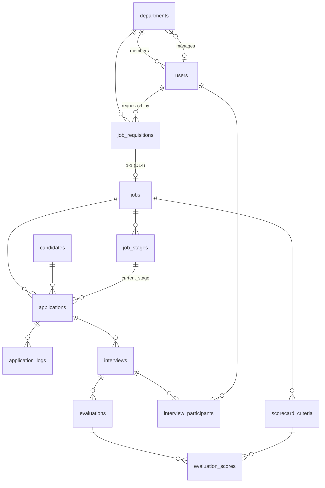

# Data Model — 13 bảng

> Nguồn sự thật thực thi: [`backend/prisma/schema.prisma`](../backend/prisma/schema.prisma). File này giải thích ràng buộc và bất biến.

| Module | Bảng | Ràng buộc / bất biến quan trọng |
|:--|:--|:--|
| auth | `departments` | `name` UNIQUE; `manager_id` nullable (phá vòng FK với `users`) |
| auth | `users` | `email` UNIQUE; `department_id` nullable; không bao giờ trả `password_hash` |
| recruitment | `job_requisitions` | CHECK `headcount > 0`, CHECK `0 <= filled_count <= headcount` |
| recruitment | `jobs` | `requisition_id` UNIQUE (D14); CHECK `pass_score_threshold BETWEEN 1 AND 5` |
| recruitment | `job_stages` | UNIQUE(`job_id`,`stage_order`), UNIQUE(`job_id`,`stage_code`); thứ tự cố định (D07) |
| recruitment | `scorecard_criteria` | CHECK `weight_percent BETWEEN 1 AND 100`; tổng theo Job = 100 (kiểm ở service, trong transaction) |
| candidate | `candidates` | `email` UNIQUE (đã chuẩn hoá); index `phone` (đã chuẩn hoá) |
| pipeline | `applications` | UNIQUE(`job_id`,`candidate_id`); `tracking_token` UUID UNIQUE; `resume_url` = snapshot; các cột calibration & duyệt offer (D05, D11) |
| pipeline | `application_logs` | Ghi ở **mọi** lần chuyển vòng; `from_stage_id` null = lúc nộp đơn; `changed_by` null = ứng viên/hệ thống |
| pipeline | `interviews` | Tối đa 1 buổi `status != CANCELLED` mỗi đơn (D01, kiểm ở service) |
| pipeline | `interview_participants` | UNIQUE(`interview_id`,`interviewer_id`) |
| evaluation | `evaluations` | UNIQUE(`interview_id`,`interviewer_id`); bất biến sau khi tạo (D06) |
| evaluation | `evaluation_scores` | UNIQUE(`evaluation_id`,`criteria_id`); CHECK `score BETWEEN 1 AND 5` và `score*2` là số nguyên (bước 0.5) |

## Ánh xạ thứ tự vòng (D07)

| `stage_code` | `stage_order` | Bắt buộc |
|:--|:-:|:-:|
| APPLIED | 1 | ✔ |
| SCREENING | 2 | tuỳ chọn |
| TEST | 3 | tuỳ chọn |
| INTERVIEW | 4 | ✔ |
| OFFER | 5 | ✔ |
| HIRED | 6 | ✔ |
| REJECTED | 99 | ✔ (ngoài luồng) |

`stage_order` giữ số cố định kể cả khi bỏ vòng tuỳ chọn (ví dụ Job không có TEST thì không có dòng order 3); "vòng kế tiếp" = dòng có `stage_order` nhỏ nhất lớn hơn vòng hiện tại (bỏ qua 99).

